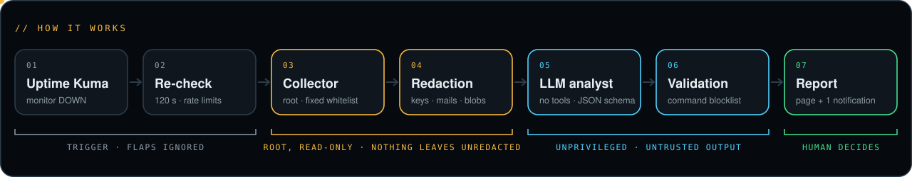

<picture><source media="(prefers-color-scheme: dark)" srcset="docs/banner-dark.svg"><source media="(prefers-color-scheme: light)" srcset="docs/banner-light.svg"></picture>

<p>
  <a href="https://github.com/moutaz121493/diag-agent/actions/workflows/tests.yml"></a>
  
  
  
  
</p>

When a service on my Raspberry Pi 5 home server goes down, this agent collects evidence, has an AI explain
what happened, writes an incident page and sends one phone notification with the likely cause and the
commands to fix it. **It never runs anything itself**: it only diagnoses, and a human decides.

It has run on the Pi since October 2026, watching about 30 services (Docker containers, systemd services,
DNS, backups, disks, a Cloudflare tunnel).

<picture><source media="(prefers-color-scheme: dark)" srcset="docs/pipeline-dark.svg"><source media="(prefers-color-scheme: light)" srcset="docs/pipeline-light.svg"></picture>

## Why it is built this way

- **Privilege separation.** Only the collector runs as root, and it can only run commands that are written
  in the code. The config file picks from built-in checks (`http`, `dig`, `cert`, `backup_status`) and lists
  container/unit names, which are checked against a strict pattern. A config file can never add a command.
- **The AI is untrusted.** It runs as a separate unprivileged user with every tool disabled, gets only
  redacted text, and must answer in a fixed JSON schema. The prompt tells it the evidence is untrusted
  data (log lines could contain prompt injection). Its answer is validated, and suggested commands that
  match a blocklist (`rm -r`, `prune`, `fsck`, `mkfs`, `dd`, `umount`, reading `.env` files, ...) are dropped
  before anyone sees them.
- **Nothing is executed from the answer.** The page says "run them yourself".
- **Redaction before anything leaves the machine**: bearer tokens, `key=value` secrets, notification topic
  URLs, URL query strings, e-mail addresses, long hex strings and base64-like blobs.
- **Cost control.** Gemini (through the Gemini CLI) is tried first and is free at this volume. Claude
  (Claude Code in print mode) is only the fallback, capped per run (`--max-budget-usd`) and optionally per
  month through a shared budget module. Plus: one diagnosis per monitor per 30 minutes, 10 per day.
- **Sandboxed.** The systemd unit uses `ProtectSystem=strict`, so the whole filesystem is read-only for the
  agent except its state and the incident pages.

## Lessons the code encodes

Real false alarms that changed the code:

- **"The HDD is mounted read-only"**: wrong, twice. Inside the `ProtectSystem=strict` sandbox *every* path
  looks read-only. The collector now reads the host's mount table (`findmnt --task 1`, marked
  "host view"), and the prompt only allows calling a disk read-only if those options start with `ro,`.
- **"Unmount and remount the disk"**: a dangerous suggestion on a server with Docker bind mounts. Banned in
  the prompt *and* filtered by the blocklist.
- **Flapping monitors** caused useless diagnoses, so a DOWN is re-checked after 120 seconds first.
- **`known-issues.txt`** gives the model the server's history (e.g. "the HDD used to drop on the old power
  supply", "`get_throttled=0x80000` is a past soft temperature limit, not a power problem"), which made the
  diagnoses noticeably more specific.

## Also in this repo: jobwatch

`jobwatch/` closes a gap Uptime Kuma has: *is every scheduled job still running?*

- `jobrun NAME MAXAGE command...` wraps each cron job and records its last success in `~/.jobs/`.
- `jobwatch.py` (cron, every 5 min) pushes up/down to a Kuma push monitor "Scheduled jobs", naming every
  job whose last success is older than its MAXAGE and every watched systemd timer whose last run failed for
  20+ minutes. If jobwatch itself stops, the push monitor goes down on its own.
- So a silently broken cron job becomes a normal Kuma outage, which diag-agent then diagnoses.

```
*/30 * * * * jobrun my-sync 7200 /usr/bin/python3 /opt/my-sync/sync.py
*/5  * * * * /usr/bin/python3 /usr/local/bin/jobwatch.py
```

When you remove a cron job, also delete its `~/.jobs/<name>.ok` file, or jobwatch keeps reporting it as late.

## Setup

Requirements: Python 3.11+ (standard library only), systemd, Docker (for container checks), Uptime Kuma
with a **status page** that lists the monitors (the agent reads its public JSON API), and at least one of:

- `gemini-ask`: any command that takes the system prompt as its last argument and the input on stdin,
  accepts `--tag`, `--timeout`, `--effort` and `--schema`, and prints the JSON answer (mine runs the
  Gemini CLI as a locked-down user), or
- Claude Code installed for an unprivileged user (`claude -p` works for that user).

```bash
sudo install -m 755 diag-agent.py /usr/local/bin/diag-agent.py
sudo mkdir -p /etc/diag /var/lib/diag /var/www/incidents
sudo cp examples/monitors.json examples/known-issues.txt /etc/diag/     # then edit both
sudo cp systemd/diag-watch.* /etc/systemd/system/
sudo systemctl daemon-reload && sudo systemctl enable --now diag-watch.timer

sudo diag-agent.py list                  # monitors from the config
sudo diag-agent.py collect "Paperless"   # print the redacted evidence, no AI
sudo diag-agent.py test "Paperless"      # evidence + AI diagnosis, printed, no notification
```

### Tests

```bash
python -m unittest discover -s tests -v   # standard library only; runs in CI on Python 3.11 – 3.13
```

They cover the parts that keep the agent safe: redaction of secrets, the JSON-schema validation and the command
blocklist, config values that try to inject commands, HTML escaping and pruning of incident pages, and jobwatch.

Monitor names in `monitors.json` must match the monitor names in Kuma. A monitor that is not in the config
still gets the generic evidence.

### Settings (environment variables)

| Variable | Default | |
|---|---|---|
| `KUMA_URL` | `http://127.0.0.1:3001` | Uptime Kuma |
| `KUMA_STATUS_PAGE` | `home` | slug of the status page with the monitors |
| `DIAG_CONFIG` / `DIAG_KNOWN` | `/etc/diag/monitors.json` / `known-issues.txt` | |
| `DIAG_SITE` | `/var/www/incidents` | where incident pages are written (kept 90 days) |
| `DIAG_PUBLIC_URL` | `http://localhost/incidents` | link in the notification |
| `DIAG_NOTIFY` | `/usr/local/bin/notify` | `notify <channel> <prio> <title> <msg> <tags> <url>`, e.g. an ntfy wrapper |
| `DIAG_ENGINE` / `DIAG_FALLBACK` | `gemini` / `claude` | `claude` / `none` |
| `DIAG_GEMINI_ASK` | `/usr/local/bin/gemini-ask` | |
| `DIAG_CLAUDE_USER` / `DIAG_CLAUDE_BIN` | `claude-runner` / `~/.local/bin/claude` | |
| `DIAG_MODEL` | `sonnet` | Claude model for the fallback |
| `DIAG_MONTHLY_USD` | `3` | monthly cap if `ai_budget.py` is present in `/usr/local/lib` |
| `DIAG_BACKUP_STATUS` | `/var/backups/STATUS` | file read by the `backup_status` check |

## License

MIT
